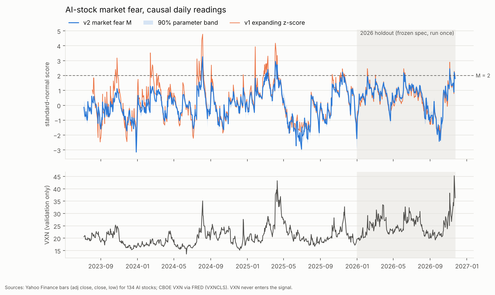

# fear-signal

A causal, price-only **fear index for AI stocks**, built only on data from
2023-01-03 onward. Per stock and day it measures how far below the previous
close the stock traded at its worst moment, in units of the stock's own
normal daily move. It filters that through a three-regime hidden Markov
model (calm / stressed / panic) and reports:

| output | meaning |
|---|---|
| `Z`, `F` | stock fear on a standard-normal scale, and 0–100 (`F = 100·Φ(Z)`); bands calm < 1 ≤ uneasy < 1.5 ≤ stressed < 2 ≤ acute fear < 2.5 ≤ panic |
| `Z_lo`, `Z_hi` | 90% band from parameter uncertainty (block bootstrap) |
| `q_next` | calibrated probability that tomorrow's low is ≥ 3 own-sigmas below today's close |
| `I` | the stock's fear relative to the other AI stocks that day (robust z) |
| `breadth` | expected share of AI stocks currently in a stressed or panic regime |
| `M` | **v3** market fear: logit breadth on a fixed linear yardstick, `(logit breadth − μ)/σ` (v2: the percentile score below) |
| `M_pct`, `F_M` | breadth's percentile among calibration days, as a normal score and as 0–100; **bands and alerts use this** |
| `M_lo`/`M_hi`, `M_pct_lo`/`M_pct_hi` | 90% parameter bands; **high-conviction fear** means `M_pct_lo ≥ 2` |
| `M_legacy` | the v1 market index (expanding z-score of mean Z), kept for comparison |

Inputs are adjusted close, close and low, and nothing else. VXN is used only
to validate.

## Status

* **v3 (current), frozen 2026-11-23, awaiting its prospective test.** v3
  changes the market index's scale to the object v2's dev selection actually
  chose, and changes how the volatility test is run. Everything else is v2.
  The market-scale change was selected on 2023–2025 alone and passed a
  data-snooping-robust gate after 2026 had been spent. The volatility-test
  change is an evaluation convention with no improvement claimed
  (`docs/V3.md`). Its single pre-registered
  read is the first 400 sessions after 2026-11-23, around mid-2028
  (`docs/PREREGISTRATION_v3.md`). The code refuses to read that sample
  earlier.
* **v2, frozen 2025-12-31, tested once on 2026.** Its verdict is below.

## Model 2: the trading model (`docs/TRADING.md`)

A second model reads the fear index's outputs at each close and decides
what to trade at the next open: AI stocks only, long only, options within
level-2 approval. Sizing and option choice are declared but not yet wired
into the live report. Its rules came from an independent design panel and
were declared before any backtest (`research/trading/`). They were audited,
selected on 2024–2025 and read once on 2026.

| family | 2024–25 (dev) | 2026 (one read) | status |
|---|---|---|---|
| ND: stock-specific news gap-down on a calm day → trails β × the AI basket for 20 sessions (bearish information) | +2.3% per event (clustered t 1.6–1.8); calibrated SPA p 0.02 on the calendar-time series, 0.057 on the 1/H series; marginal: dropping any one of 4 single events puts it outside Holm, and the events an earlier study never touched show no effect | +2.1% per event (clustered t 1.0; calendar-time t 0.6); uninformative, as 40% of random names also "agree" | **Tier 1 (pilot, dev evidence only)**: rotate out of a newly flagged name into the AI basket for 20 sessions; open windows mean "do not add" |
| SR: buy the most displaced names after systemic fear days | −0.3% per event, t −0.9 | +0.4% per event (median −0.06%, two news jumps); calendar-time t 2.1 from thin sessions | Tier 0: failed dev, and 2026 cannot select it |
| RF: cut basket exposure when market fear is high | variance −16%, almost all from April 2025 | variance −1%, tails worse | OFF: not confirmed |

**No rule has reached high conviction.** The model says so, and it shows
every signal with its tier.

**v2 (2026-11-28) changed nothing live.** Details are in
`research/trading/v2/` and the v2 section of `docs/TRADING.md`.
* **Return search.** A fully counted search of 215 more rules on dev
  (14.6 effective trials) had five StepM survivors. All five failed the
  deflated-Sharpe gate, and none replicated in 2026.
* **Risk skill.** Model 1's one validated skill is risk forecasting. Its
  QLIKE advantage over EWMA held out of sample in 2026, at about half the
  dev size.
* **Options (H_VOL).** A pre-registered test on 339 rebuilt option pairs
  found that model 1's forecast adds nothing beyond listed implied
  volatility. Its straddle rule missed the declared bar (dev p 0.053).
* **Prospective test.** Model 2's only clean test is now declared
  (`research/trading/PROSPECTIVE.md`): the first 400 sessions after
  2026-11-27, read once.
  - It tests ND1 and the risk skill.
  - The declared sequential guard and demotion rules now run in
    `trading-live`.

## Verdict (2026 holdout, frozen spec, run once)

| pre-registered test | 2026 result | |
|---|---|---|
| H1 M tracks VXN (5-session changes) | Spearman 0.548 (95% CI 0.39–0.67); levels 0.81 | **pass** |
| H3 / H3b reads high when hit, no false panic | 559/559 three-sigma loss days at Z ≥ 1.5; 0/139 panics without a dip | **pass** |
| H2 tail forecast calibrated, skilful | slope 0.801 (s.e. 0.118; floor 0.8, fragile); Brier skill +0.7% vs climatology (t 1.44) | **pass, at the boundary** |
| H2b beats an \|x\| EWMA | +1.7% Brier skill | **claimed** |
| H1b v2 market index beats v1's | −0.035 (CI −0.077 to +0.001) | not claimed |
| H4 adds to a HAR volatility forecast | DM-HLN t 0.86 | fail |
| H5 predicts returns | Hodrick 1B t 0.70 | fail |

**A validated fear thermometer and a calibrated next-day tail-risk
probability. Not a return predictor.** v1's stock model was independently
replicated and beat every alternative tested. The new market aggregation
(breadth) did not beat v1's on the primary 2026 test; the two are
statistically indistinguishable. The value v2 adds is a calibrated forecast,
stated uncertainty, a fixed yardstick, and claims that can be checked. Full
write-up: `docs/RESULTS.md`.

Latest reading (2026-11-23):
- v2 frozen: **M = 1.80** (90% band 1.65–1.94), *stressed*; expected share of AI stocks in a stressed or panic regime 74%.
- v3: **M = 2.17** (band 2.00–2.23) on its linear scale; percentile score 1.95, *stressed*; breadth 82%. 2026-11-20 was a high-conviction *acute fear* day (M_pct_lo ≥ 2).

The two versions differ on 11-23 for two reasons. Re-estimation with 2026
data, in which the stressed regime is stickier (self-transition 0.93 against
0.89), moves the percentile score from 1.80 to 1.95. The change of scale, from
percentile to linear, moves the headline from 1.95 to 2.17.



## How it was built

1. **Hard rules in code.** Nothing before 2023-01-03 may enter a computation
   (`config.assert_era`). 2026 is a locked holdout: development code cannot
   load it, and the holdout loader requires the SHA-256 of a committed,
   unmodified `config/frozen.json`.
2. **Pre-declared comparison on 2023–2025.** Six stock-layer candidates and
   three market-layer readings were scored by expanding-window walk-forward,
   using rules committed before the run. The v1 emission design survived. The
   two corrections I proposed (censored clipping, modelled no-dip days) were
   rejected out of sample. Breadth replaced v1's expanding z-score.
   → `docs/RESULTS.md` §1
3. **Freeze, pre-register, run once.** Parameters, quantile maps, 200 bootstrap
   replicates, climatology, HAR coefficients and test thresholds were frozen.
   The hypotheses and pass criteria were written down and committed before
   any 2026 data was downloaded. → `docs/PREREGISTRATION.md`
4. **Independent correctness review** of the code by a separate agent before
   the freeze, and of the results after (`docs/REVIEW.md`).
5. **Course correction without overfitting (v3).** Four agents diagnosed the
   2026 weak spots, and an adversarial critic tried to refute every fix.
   Changes were chosen only on 2023–2025 walk-forward, through a calibrated
   Hansen-SPA family gate with Holm. One signal change passed. One promising
   stock-layer idea (F5) passed the statistical gate but failed its mechanism
   and market-layer conditions; it is frozen as a prospective challenger
   instead. → `docs/V3.md`, raw provenance in `research/v3/`

The math, with derivations (reflection principle for the half-normal,
severity as posterior mean log-volatility, exact EM for censored and
zero-inflated emissions, why breadth rather than a pooled likelihood):
`docs/METHODOLOGY.md`. Data handling and universe: `docs/DATA.md`.

## Usage

```bash
python -m venv .venv && .venv/bin/pip install -e ".[data,plot,dev]"
.venv/bin/python -m pytest                      # engine, math and protocol tests

fearsignal download-dev                          # 2023-01-03 .. 2025-12-31
fearsignal evaluate-dev                          # walk-forward comparison
fearsignal freeze --stock-spec S1_v1_refit       # writes config/frozen.json
fearsignal dev-reference                         # in-sample reference metrics
fearsignal download-holdout --end-exclusive YYYY-MM-DD
fearsignal holdout --sha256 <sha256 of config/frozen.json>
fearsignal latest                                # latest market and stock readings

# live readings (display only; never the prospective test)
fearsignal live --days 7                          # Yahoo bars, downloaded here
fearsignal live --days 7 --source robinhood       # Robinhood bars saved by the agent (below)

# v3
fearsignal posthoc-2026                          # labelled diagnostic of the v3 market scale
fearsignal freeze-v3                             # re-estimate on 2023-01-03..2026-11-23
fearsignal v3-reference                          # in-sample v3 metrics (reference only)
fearsignal download-prospective --end-exclusive YYYY-MM-DD   # only after v3 is committed
fearsignal prospective --sha256 <sha256 of config/frozen_v3.json>  # once, at 400 sessions

# model 2, the trading model (docs/TRADING.md)
fearsignal trading-placebo                         # calibrate the selection gate on placebo families
fearsignal trading-dev                             # once: dev selection, writes config/trading_selected.json
fearsignal trading-holdout --sha256 <sha256 of config/trading_selected.json>   # once
fearsignal trading-data --end-exclusive YYYY-MM-DD # refresh live prices (backtest inputs are hash-locked)
fearsignal trading-live --days 6                   # both models on recent sessions, and the next session
```

**Robinhood as the live price source.** The pipeline cannot call the
Robinhood connector itself, so the agent does. It calls
`get_equity_historicals` for the 134 tickers (interval `day`,
`adjustment_type` `all`, starting a few sessions before the last frozen
date) and saves the JSON results unchanged in `data/raw/robinhood/`, which
is git-ignored. `--source robinhood` then:
- scales those bars onto the frozen history per ticker, checking that the
  scale is constant across the overlap (closes agree within 0.2%);
- fills bars the Yahoo pull is missing or broken on;
- uses Robinhood for every completed session after 2026-11-23.

A session still in progress has no Robinhood daily bar. A newer partial
Yahoo bar is then shown as provisional.

Outputs: `outputs/holdout/market_fear.csv` (daily M, band, breadth,
legacy M), `outputs/holdout/stock_fear.csv.gz` (per stock-day x, Z, band, F,
I, q_next, state probabilities), `outputs/holdout/holdout_results.json`.

## Layout

```
src/fearsignal/
  config.py     era and holdout guards, constants
  universe.py   134 AI value-chain stocks, 11 segments, listing overrides
  data.py       download, manifest hashes, panels, holdout loader
  features.py   robust scale and drawdown-to-low observation
  hmm.py        scaled filter/smoother, exact EM, half-normal and Gaussian emissions,
                regime-indexed transitions
  scoring.py    severity, logit, frozen quantile map, Z/F/bands, robust I
  market.py     breadth, legacy M, market summary
  model.py      candidate specs, fitting, full signal, tail forecast
  bootstrap.py  synchronised moving-block bootstrap in time
  stats.py      Newey-West, HAC OLS, stationary bootstrap, calibration, Clark-West, Hodrick 1B
  spa.py        Hansen SPA (calibrated), model confidence set, episode robustness
  evaluate.py   dev walk-forward harness
  validate.py   pre-registered tests
  pipeline.py   freeze / apply / holdout
  figures.py    docs figures
  report.py     renders the holdout section of RESULTS.md from JSON
  trading/      model 2: pit (point-in-time fear refits), market_data, signals (rule features),
                families (the declared rules), registry, engine (cohort and calendar-time
                accounting), gates (SPA, Holm, 1-SE), placebo, backtest, protocol (locks),
                risk and sizing, options, calendar, live
tests/          engine vs brute force, EM properties, causality, protocol, test sizes;
                trading engine probes and an end-to-end synthetic protocol run
research/v3/    raw provenance of the v3 course-correction round
research/trading/  the trading model's design proposals, declaration, amendments and audit
```

## Known limitations

* The universe is chosen with 2026 hindsight (survivorship, AI-winner
  selection). That matters little for a contemporaneous thermometer, but it
  biases forward-return tests.
* The sample is short. 2023-H2 to 2026 holds only a handful of independent
  market stress episodes, which is the binding limit on every confidence
  interval here.
* Raw vendor data is not redistributed. `data/manifest_*.json` records
  hashes so a fresh download can be checked.
