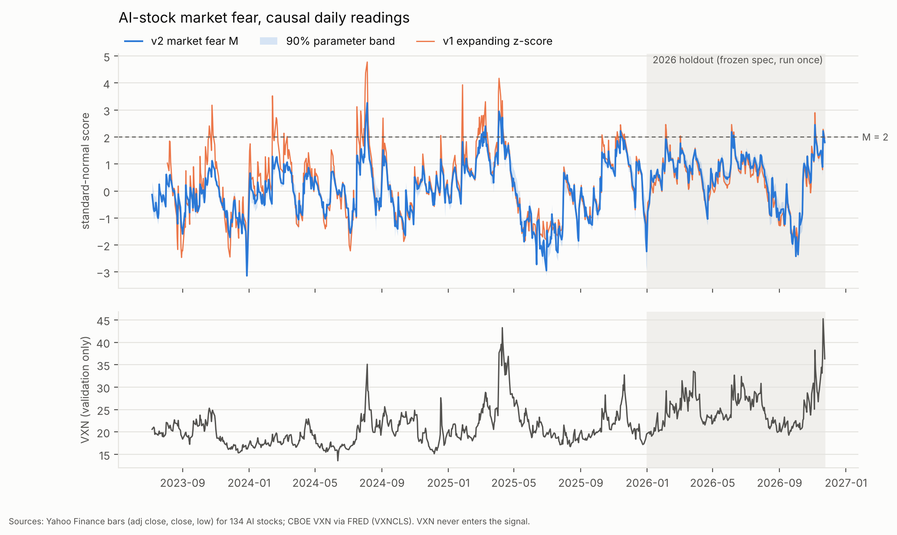
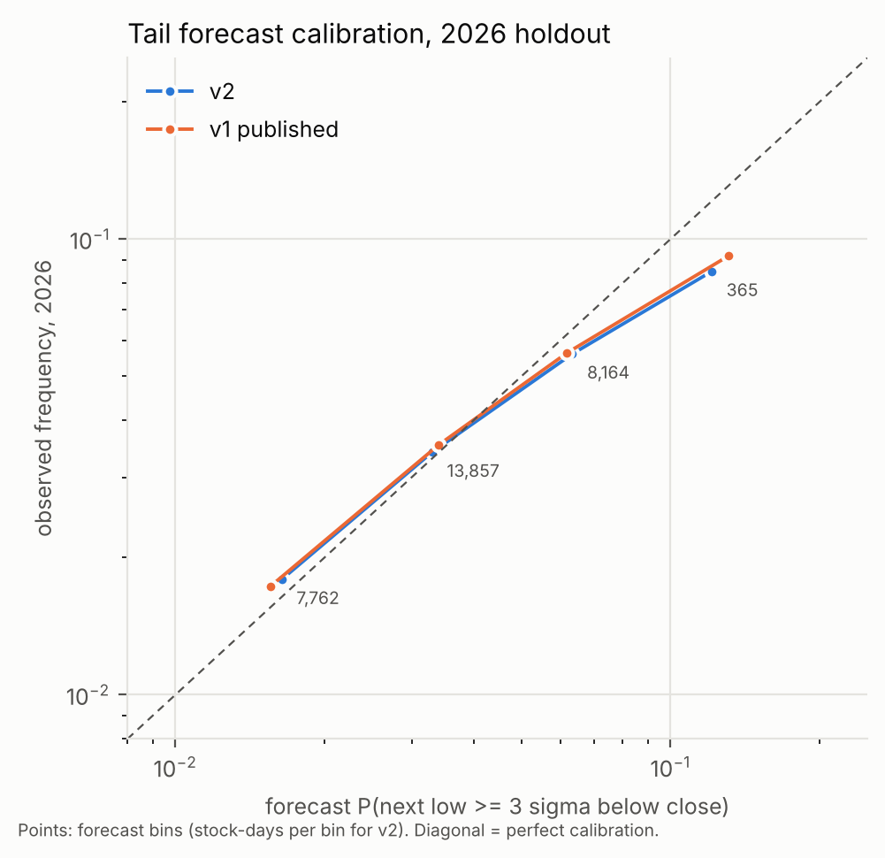

# Results

## 1. Development: walk-forward model comparison (2023–2025 only)

Three expanding folds. Every quantity is refit on the training window, and
only test days are scored: test halves 2024H2, 2025H1, 2025H2, totalling 378
sessions and 48,862 stock-days (48,851 in the Brier comparison, which also
needs both EWMA baselines). Source: `outputs/dev/walkforward.json`,
produced by `fearsignal evaluate-dev`, which is deterministic.

### Stock layer: one-step predictive log score (higher is better)

| candidate | params | log score / obs | vs best (NW s.e.) | Brier skill vs climatology | vs \|x\| EWMA | vs x² EWMA | calibration slope (day-clustered s.e.) |
|---|---|---|---|---|---|---|---|
| S0 v1 published (reference) | 11 | −1.32562 | +0.00547 (0.00366) | +2.7% | +1.2% | +3.3% | 0.98 (0.18) |
| **S1 v1 refit** (selected) | 11 | **−1.33108** | best | +1.8% | +0.35% | +2.4% | 0.98 (0.19) |
| S2 shared atom, censored, K=3 | 12 | −1.33171 | −0.00062 (0.00075) | +1.7% | +0.23% | +2.3% | 0.96 (0.19) |
| S3 per-state atom, censored, K=3 | 14 | −1.33215 | −0.00106 (0.00101) | +1.6% | +0.15% | +2.2% | 0.95 (0.18) |
| S4 per-state atom, censored, K=2 | 7 | −1.34098 | −0.00989 (0.00292) | +1.6% | +0.15% | +2.2% | 0.76 (0.15) |
| S5 per-state atom, censored, K=4 | 23 | −1.33158 | −0.00050 (0.00114) | +1.7% | +0.19% | +2.3% | 0.95 (0.18) |

Reading:

* **v1's emission design survives.** Censoring the clipped values and
  modelling no-dip days are correct in principle and fit better in-sample,
  but neither improves out-of-sample prediction. Every K = 3–4 variant is
  within one standard error of the refit v1 model, and the coded
  one-standard-error rule keeps the one with the fewest parameters.
* **K = 2 is clearly too few** (−0.0099 nats/obs, 3.4 s.e.) and poorly
  calibrated.
* **The free no-dip atom is unstable.** Trained through mid-2024 its fit
  had not converged after 1,500 EM iterations (recorded as
  `converged: false`, with panic π = 0.65 at the cap). The independent review
  continued it for 10,000 more iterations and π moved to about
  (0.18, 0.01, 0.82). The later folds converge with panic π ≈ 0. Either way
  the selection is unchanged.
* **S0 is not out-of-sample.** v1's published parameters were fitted on
  2023–2025, which contains every test fold. Its lead over S1 per fold is
  0.0052, 0.0111 and 0.0005 nats/obs. It is largest on 2025H1, where the
  published parameters had already seen the DeepSeek and tariff crashes
  that S1 was forecasting blind, and it all but vanishes on 2025H2, when S1's
  training window is longest. That fits look-ahead plus small-sample noise,
  not a better model.
* **The tail forecast is calibrated; its skill edge is small.** For the
  event "tomorrow's low is ≥ 3 own-sigmas below today's close" (base rate
  4.0%), q's calibration slope is 0.98. It beats climatology by 1.8% in
  Brier score, but an EWMA of |x| mapped through the same half-normal tail
  by only 0.35%. (The x² EWMA does worse than climatology because one
  censored day contributes 100.) Much of the tail is earnings-day risk
  that past prices cannot anticipate. The forecast's value is that its
  probabilities mean what they say.

### Market layer: 5-session changes vs VXN (stitched out-of-sample)

Changes are taken within each fold's test block, so none straddles two fold
models: 363 changes in all.

| market reading | Spearman (95% CI) | Pearson (95% CI) | level Spearman (95% CI) |
|---|---|---|---|
| **breadth, S1** (selected) | **0.661** (0.55, 0.75) | **0.679** (0.56, 0.76) | 0.527 (0.23, 0.75) |
| v1 expanding z-score, S1 | 0.624 (0.52, 0.71) | 0.604 (0.51, 0.68) | 0.483 (0.18, 0.71) |
| v1 expanding z-score, v1 published | 0.619 (0.51, 0.71) | 0.596 (0.50, 0.67) | 0.509 (0.19, 0.73) |
| market-level Gaussian HMM | 0.217 (0.12, 0.33) | 0.116 (0.03, 0.20) | −0.085 (−0.29, 0.21) |

Breadth beats v1's expanding z-score on every stock model in the candidate
set. On the selected model the paired Spearman gain is **+0.037
(95% CI 0.001 to 0.066)**. That is consistent in sign across all six models
and only just significant. The structural advantages count as much: a
yardstick that never moves, no early-sample instability, and a direct
reading as "the expected share of AI stocks in a fear regime".

## 2. Holdout: the single frozen run on 2026

Scored sessions: 225 (2026-01-02 .. 2026-11-23). Frozen spec SHA-256 `7be905b1633d28dbfef438d1d57cee0578266f674ab98b2556ca833015574ae5`.

### Pre-registered tests

| id | statistic | 2026 value | result |
|---|---|---|---|
| H1 | Spearman ρ(ΔM, ΔVXN), 5-session | 0.548 (0.39, 0.67) | **pass** |
| H1b | ρ(ΔM_v2) − ρ(ΔM_v1), paired | -0.035 (-0.08, +0.00) | not claimed |
| H2 | Brier skill vs climatology; calibration slope | +0.72%; slope 0.801 (s.e. 0.118); gain t = 1.44 | **pass** |
| H2b | Brier skill vs |x| EWMA (x² EWMA) | +1.69% (+2.48%) | **claimed** |
| H3 | 3-sigma loss days with Z ≥ 1.5 | 1.000 of 559 | **pass** |
| H3b | Z ≥ 2.5 readings with no 2-sigma dip in 5 sessions | 0.000 of 139 | **pass** |
| H4 | HAR+M vs HAR, OOS R²; DM-HLN | -0.041 → 0.011; t = 0.86, p = 0.196 | fail |
| H5 | 20-day return slope on M; Hodrick 1B | +0.0332 per unit M; t = 0.70, p = 0.482 | fail |

### Market fear against VXN, 2026

| reading | Δ5 Spearman (95% CI) | Δ5 Pearson (95% CI) | level Spearman (95% CI) |
|---|---|---|---|
| v2 M (breadth) | 0.548 (0.39, 0.67) | 0.515 (0.38, 0.65) | 0.806 (0.68, 0.87) |
| v1 expanding z-score, v2 filter | 0.575 (0.43, 0.69) | 0.593 (0.47, 0.70) | 0.771 (0.62, 0.86) |
| v1 as published (expanding z-score) | 0.583 (0.44, 0.69) | 0.608 (0.49, 0.71) | 0.785 (0.64, 0.87) |

### Alerts, 2026

VXN 'elevated' = at or above its dev 80th percentile (22.69); base rate 68.0%, mean VXN 25.0.

| rule | days | VXN elevated on those days | mean VXN |
|---|---|---|---|
| M ≥ 2 | 4 | 100.0% | 35.9 |
| high conviction: M_lo ≥ 2 | 1 | 100.0% | 38.3 |

### Tail forecast, 2026

Event rate 3.65% over 30,148 stock-days; mean forecast 3.80%. Brier skill vs climatology: v2 +0.72%, v1 published +0.69%.

| forecast bin | stock-days | mean forecast | observed |
|---|---|---|---|
| [0.01,0.02) | 7,762 | 1.639% | 1.791% |
| [0.02,0.05) | 13,857 | 3.300% | 3.406% |
| [0.05,0.1) | 8,164 | 6.335% | 5.598% |
| [0.1,0.2) | 365 | 12.112% | 8.493% |

### Forward basket returns (secondary)

20-day: slope +0.0332 log-return per unit of M, Hodrick 1B t = 0.70; mean 20-day return +1.54% on all days and -0.63% on the 2 days with M ≥ 2. 5-day: slope +0.0097, 1B t = 0.80.

## 3. Verdict

Applying the pre-registered mapping to the single 2026 run:

**Validated fear thermometer (H1, H3, H3b pass).** With every parameter
frozen on 2023–2025, five-session changes in M track five-session changes in
VXN at ρ = 0.55 (95% CI 0.39–0.67), and the level correlation is 0.81. Every
one of 559 three-sigma loss days read Z ≥ 1.5, and no panic reading arrived
without a visible hit. VXN never enters the signal, so this is construct
validity, not fitting.

**Calibrated tail-risk forecaster — met the floor at its boundary (H2 passes,
H2b claimed).** q's calibration slope is 0.801 (day-clustered s.e. 0.118)
against a pre-registered floor of 0.8. The pass is fragile: dropping any one
of 83 of the 225 days pushes the slope below 0.8 (leave-one-day-out range
0.741–0.830; the lowest comes from dropping 2026-11-05). Its Brier skill is
+0.7% over climatology (t = 1.44, not significant, as the pre-registration
anticipated) and +1.7% over an |x| EWMA. The top forecast
bin over-predicts (12.1% forecast vs 8.5% observed). A slope below 1 means
the forecasts were somewhat too spread out: the riskiest-looking days in 2026
were less risky than the 2023–2025 regimes implied.

**Not a volatility increment (H4 fails), not a return predictor (H5
fails).** M's out-of-sample gain over a HAR volatility forecast is positive
but insignificant (DM-HLN t = 0.86). Forward returns show no relation that
survives a correctly sized test (Hodrick 1B t = 0.70). On returns the verdict
is the same as v1's: thermometer, not crystal ball.

**The new market aggregation did not beat v1 on the primary test (H1b
fails).** On 2026 five-session changes, breadth-based M was slightly *worse*
than v1's expanding z-score (−0.035, CI −0.077 to +0.001). The dev-period
gain of +0.037 did not replicate. On levels, which were not a pre-registered
test, M is slightly better (0.81 vs 0.79). The two readings are
statistically indistinguishable; M keeps a fixed yardstick and a direct
interpretation, and v1's index is still published alongside it
(`M_legacy`).

**The starting point replicates.** Refit on a different 134-stock universe,
v1's parameters land inside this study's bootstrap 90% intervals. Run as
published, v1 gives a 2026 five-session Pearson correlation with VXN of
0.61, against the 0.62 its author reported.

### What v2 contributes, in order of weight

1. **Evidence that v1's stock model is the right one.** Its emission was
   tested against censored, zero-inflated and 2- and 4-regime alternatives
   in a pre-declared walk-forward, and none beat it out of sample.
2. **A forecast with a meaning.** q is a per-stock, per-day probability. On
   unseen data it met the pre-registered calibration floor, only at its
   boundary, with a small positive skill.
3. **Stated uncertainty.** Every score carries a 90% parameter band from a
   time-block bootstrap. A *high-conviction* market reading (M_lo ≥ 2)
   occurred on one 2026 day (2026-11-05, VXN 38.3). The four M ≥ 2 days all
   had elevated VXN (mean 35.9, against 25.0 for the year).
4. **Claims that can be checked.** Hard rules are enforced in code, the
   comparison was pre-declared, the spec was frozen and hashed before
   any 2026 data existed locally, there was one logged holdout run, and an
   independent correctness review came before the freeze.

### Where it stands now

Last scored session, 2026-11-23: **M = 1.80** (90% band 1.65–1.94),
*stressed*. Breadth is 0.74: the expected share of AI stocks in a stressed
or panic regime is 74% (a mean posterior probability, not a count).¹ On
2026-11-20 M reached 2.22 (*acute fear*) as VXN closed at 45.3, its highest
close of the year.

¹ 133 of 134 stocks were scored on 2026-11-20 and 2026-11-23. The vendor
has no SNDK bar for 11-20, and its 11-23 bar has a low but no close, so both
are correctly masked. The 11-20 reading does not depend on SNDK (M stays
between 2.21 and 2.23 whatever its state). On 11-23, if that partial low is
genuine, M would be up to 1.82.
